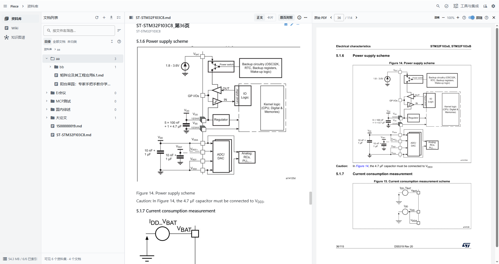
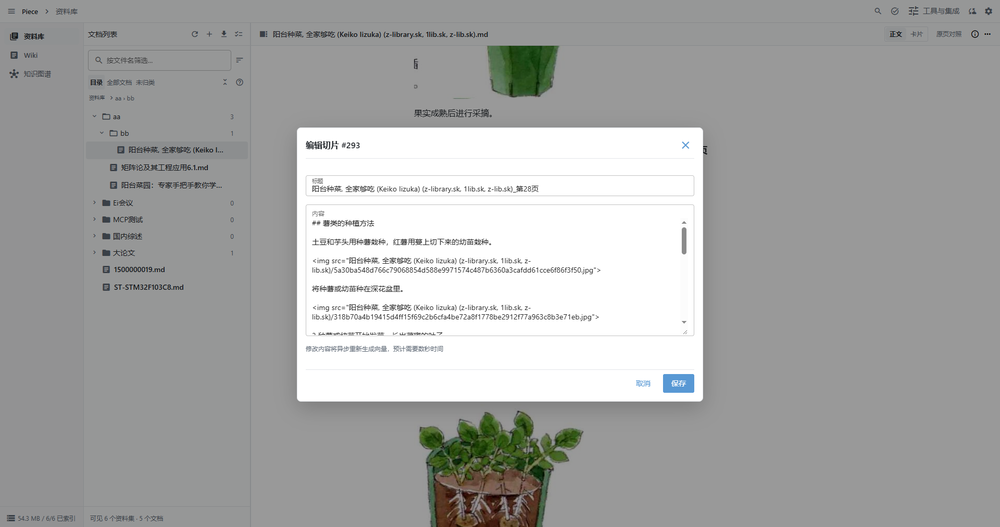
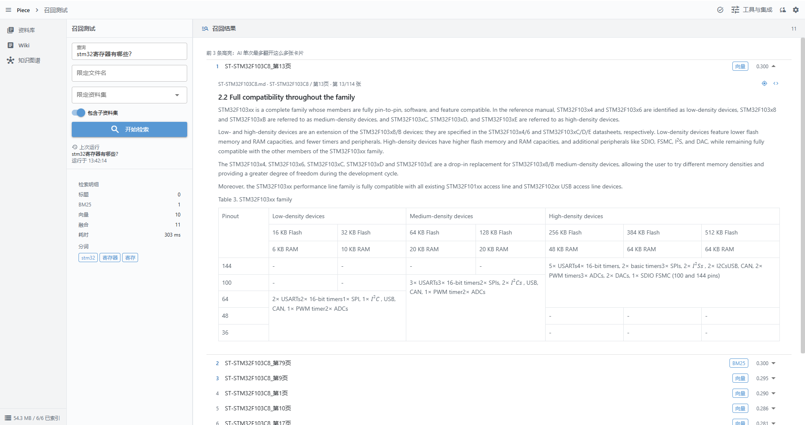
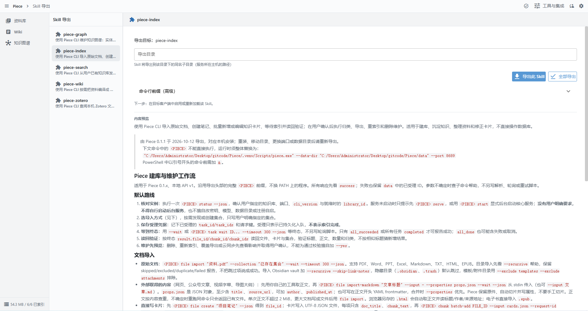
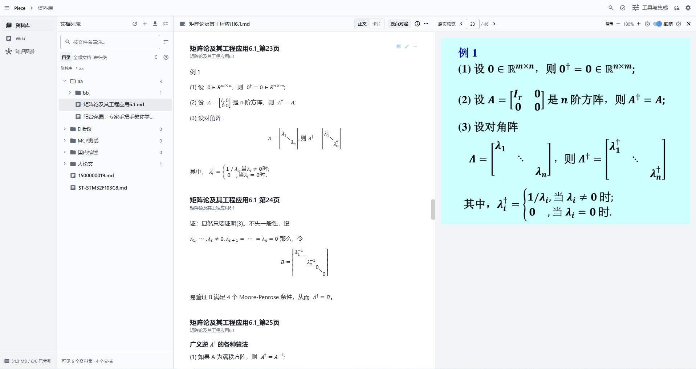
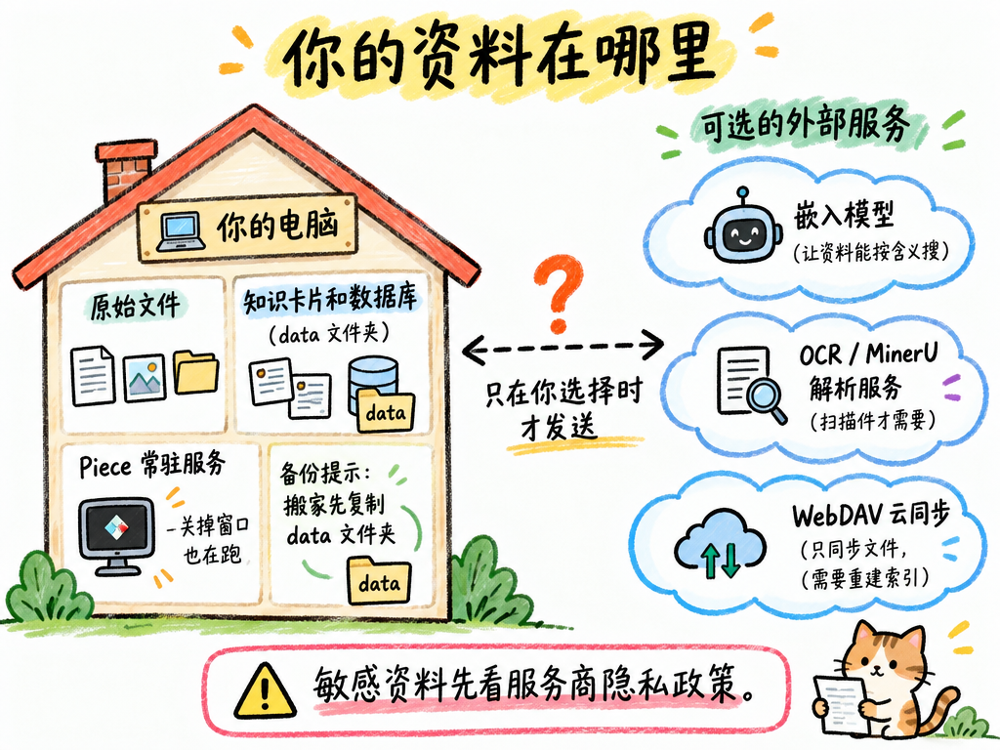

<div align="center">


# Piece

**Turn the documents on your machine into a local knowledge base your AI can cite and you can verify.**

[](https://github.com/ultraplan-bit/Piece/releases)
[](LICENSE)
[](https://www.python.org/)


[简体中文](README.md) | **English**

</div>

<a href="assets/一图看懂%20Piece.png"></a>

## ✨ What it is

PDFs, Word files, and slide decks pile up, and finding one sentence means hunting through folders from memory. Handing them to an AI doesn't scale past a few long documents, and online knowledge bases want your files on someone else's server first.

Piece keeps it simple: **your documents stay on your machine, get indexed, and the retrieval capability is handed to your AI over MCP**. The conversation still happens in Claude, Cursor, or whatever you use — Piece just supplies the relevant content and its source.

<a href="assets/为什么选%20Piece.png"></a>

## 🧩 What it does

- **Import becomes cards**: PDF, Word, PowerPoint, Excel (`.xlsx`), Markdown, TXT, HTML, and EPUB, parsed into individual knowledge cards.
- **Editable and verifiable**: fix titles and text on the spot, with the original PDF page alongside so parsing errors are easy to spot.
- **Hybrid retrieval**: BM25 plus vector search, fused and ranked with RRF.
- **Connects to your AI**: two MCP services — read-only `piece-kb` for searching, plus `piece-index` when you want the AI to write notes and edit cards. Skills can also be exported for terminal-based AI.
- **Organize as you go**: hierarchical collections, Wiki pages, a knowledge graph, and one-shot imports from Obsidian and Zotero.
- **Local-first**: SQLite + FTS5 + sqlite-vec for storage, a NiceGUI interface, and a service that runs on your own machine.

## 🖼️ Screenshots

The screenshots show the Chinese interface. Click any image to view it at full size.

<table>
  <tr>
    <td width="50%" align="center" valign="top">
      <a href="assets/原页对比图.jpg"></a>
      <br><b>Source comparison</b> · Check content against the original
    </td>
    <td width="50%" align="center" valign="top">
      <a href="assets/知识卡片编辑.png"></a>
      <br><b>Card editing</b> · Correct content whenever needed
    </td>
  </tr>
  <tr>
    <td width="50%" align="center" valign="top">
      <a href="assets/召回测试.png"></a>
      <br><b>Recall Test</b> · Ask a question and see what comes back
    </td>
    <td width="50%" align="center" valign="top">
      <a href="assets/skill导出.png"></a>
      <br><b>Skill Export</b> · Let terminal-based AI use your knowledge base
    </td>
  </tr>
</table>

<details>
<summary>Another example: PowerPoint formulas and source pages</summary>

[](assets/ppt原页对比图.jpg)

</details>

## 🚀 Getting started

### 1. Download and open

Grab the latest build from [**Releases**](https://github.com/ultraplan-bit/Piece/releases), unzip it fully, and double-click `Piece.exe`. The Windows build needs no Python install — just don't move the exe out on its own.

### 2. Configure an embedding model

Open **Settings → Embedding Model**. It's what lets your documents be searched by meaning, and it needs setting up once. New users can start with the default [SiliconFlow](https://siliconflow.cn/) service:

1. Get an **API Key** from the provider's console;
2. Paste it into Piece — leave the default URL and model as they are;
3. Click "Test Connection" and save once it succeeds.

Other compatible services work too. Third-party services may charge, and their quotas and pricing are their own.

### 3. Import documents

On the **Library** page, click **+ → Upload File**, choose your files, and wait for processing to finish — knowledge cards will appear. For scans, complex formulas, or tables, first set up a parsing service under **Settings → PDF Parsing** (PaddleOCR, MinerU, or a custom multimodal model); plain text PDFs can be imported directly. Then open **Recall Test** and ask a question to see whether it finds what you expect.

### 4. Connect your AI

**Option 1 · MCP**: open the **MCP Configuration** page, pick your client, copy the config, save it, and reload.

- Search only: choose the read-only `piece-kb` service;
- Also let the AI write notes and edit cards: add the `piece-index` service;
- Look up Zotero references: choose `piece-zotero` separately.

**Option 2 · Skills**: if your AI can run local commands, export workflows from the **Skill Export** page — `piece-search` to look things up, `piece-index` to import and organize, `piece-wiki` to compile pages, `piece-graph` to maintain the graph, and `piece-zotero` for references.

Once connected, ask in your AI client:

> Find what my documents say about this topic and cite the sources.

Piece supplies the documents; the chat and the answer still happen in your AI client.

## 🔒 Data and privacy

<a href="assets/安心用.png"></a>

Files and the database are stored locally. Only when you choose to use a cloud model, OCR, or parsing service is the relevant text sent to that service, and your AI client reads the content you retrieve. Before handling sensitive material, check the privacy policy of the services you use.

Closing the window does not stop the background service; to exit completely, choose "Quit" from the system tray. Data lives in the `data/` folder next to the program by default — fully exit before upgrading or moving, and back up the `wiki/` Markdown files together with the SQLite database, not the database alone.

## ❓ FAQ

**Imports fail, or the AI can't find anything.**
Check the model connection, file processing status, and client configuration. Scans also need a parsing service. Look in "Logs" for the specific error.

**Can I sync across machines?**
Yes, via "Cloud Sync" with a WebDAV service such as Nutstore. It syncs files only and is not a full knowledge base backup — other devices need to rebuild their index. Later syncs favor the local side and may overwrite cloud files, so back up first.

<details>
<summary>Advanced: running from source, CLI, MCP writes, Wiki and graph, Zotero</summary>

<a href="assets/资料的一生.png"></a>

### Running from source

Piece requires Python 3.12+. Managing the environment with [uv](https://docs.astral.sh/uv/getting-started/installation/) is recommended:

```bash
git clone https://github.com/ultraplan-bit/Piece.git
cd Piece
uv sync --python 3.12 --locked --extra desktop
uv run --extra desktop piece serve --open
```

macOS and Linux can run from source with the browser interface, though real-hardware compatibility is still being polished. For command help, run `uv run --extra desktop piece --help`; the Windows portable build uses `piece-cli.exe` in the terminal.

### Managing a knowledge base from the CLI

In the commands below, replace `piece` with `uv run --no-sync piece` in a source environment, or `piece-cli.exe` in the portable build. Business commands require the Piece service to be running.

```bash
piece config init --interactive   # Configure the embedding model in the terminal; the key is hidden and only saved after confirmation
piece start                       # Start the core service in the background and return once it is ready
piece config test embedding       # Explicitly reach the configured model service and check the connection and dimensions
piece file import "document.md" --wait
piece file list --name "document" # Substring match on file names, not full-text search or wildcards
piece stats                       # Imported files, indexed files, chunk count, and total original size
piece status
piece stop                        # Request a stop; the service finishes in-flight work before exiting
```

- Without `--interactive`, `config init` is still non-interactive, and a script can follow up with `config update --offline --input patch.json`. The wizard never goes online on its own and leaves existing admin/MCP keys untouched; saving offline is refused while the service is running, and an existing index cannot switch embedding model, endpoint, or dimensions directly.
- `start` enables neither GUI, MCP, nor tray by default; use `start --gui --mcp` or `start --open --mcp` when you need them. Background startup waits up to 60 seconds by default (adjust with `--timeout`); a timeout or Ctrl+C only stops waiting and does not kill the background process.
- With a custom knowledge base, keep the same `--data-dir` and `--port` for every command. `--data-dir` is the config directory; actual storage is still governed by the configured `data_path`.
- If files are already in `files/originals/`, preview with `piece file scan --dry-run` and then register and index them with `piece file scan --wait`.

### MCP writes, Wiki, and graph

For MCP writes, prefer the intent tools on the index service: `knowledge_object_add` / `knowledge_object_update` / `knowledge_relation_add` / `knowledge_relation_update` and `wiki_page_add` / `wiki_page_update`. Arguments are flat, evidence is inlined as `CHUNK_ID:line` or `CHUNK_ID:grep=substring`, and `request_key` is generated and returned automatically. They share assembly logic with the CLI's `graph object add` and `wiki page add`; use the batch tools `knowledge_apply` / `wiki_apply` when submitting many records at once or when you need field-level control.

Wiki text and metadata are stored as Markdown files under `wiki/` in the configured `data_path`, while SQLite keeps only a rebuildable page index and a separate audit trail. In-page links use `[Title](piece://wiki/PAGE_UUID)`, so changing a title or filename does not change identity. After editing externally, run `piece wiki rebuild-index` explicitly to refresh the index; it neither rewrites the Markdown nor calls a model.

Knowledge-page evidence must quote the source verbatim. An agent can use `piece chunk extract` to cut an exact substring from card text by line number or match (available in the CLI and both MCP services); adding `--out` writes it straight to a submittable evidence file. When a match is not unique, narrow it with `--lines` first rather than guessing the first hit.

A single command writes a knowledge page, reading back by default and writing no temporary file:

```bash
piece wiki page add --kind concept --title "Incremental maintenance" \
  --summary "Only change what clearly changed" \
  --evidence CHUNK_ID:2-3
```

`--evidence CHUNK_ID:LOCATOR` can repeat; LOCATOR is a line number `N` / `N-M`, `grep=substring`, or `re=regex`, and the service cuts the exact quote and returns its hash. A single `--stance` applies to all evidence, while multiple ones map in order. Update a page with `wiki page update UUID --expected-revision N --expected-content-hash HASH`, use `graph object add/update` for entities and `graph relation add/update` for relations.

Every write generates a request key and returns it as `data.request_key`. To keep a local copy, add `--save-request` (stored under `requests/` in the data directory) or `--request-file PATH`; an existing file may only be reused if both target and content match. `--dry-run` only pre-checks — drop it and rerun the same command to submit. Content your AI client fetched itself — web pages, articles, subtitles — can be imported whole: `import_markdown` on the index MCP service, or `piece file import-markdown` for skills.

### Working with Zotero

You can query your local personal Zotero library directly, reading bibliographic data, notes, PDF annotations, and available full text without importing into Piece first. Choose attachments to import only when you need to verify something closely; identical content reuses existing files and keeps multiple sources.

```bash
piece zotero status --json
piece zotero search "keyword" --collection-key COLLECTION_KEY --limit 20 --json
piece zotero children ITEM_KEY --item-type attachment --json
piece zotero preview --attachment-key ATTACHMENT_KEY --collection-mode none --server-id SERVER_ID --json
piece zotero import --attachment-key ATTACHMENT_KEY --collection-mode none --server-id SERVER_ID --wait --json
```

A separate MCP service, `piece-zotero`, provides lookup, `zotero_import`, authorization, and change preview/execution; `piece-kb` and `piece-index` register no Zotero tools. This requires Zotero 7+ running with "Settings → Advanced → Allow other applications on this computer to communicate with Zotero" enabled. The front-end entry is **Tools → Zotero Library**, and importing is a one-time copy that leaves the original library untouched. Modifying Zotero requires the `zotero_write_enabled` config (default `false`), authorization in a Zotero popup, and then previewing the diff and executing by `plan_id`. See the [Zotero guide](skills/piece-zotero/SKILL.md) for details.

### Tips

- **Poor results**: check the card text first, then make the title specific — "API auth: token refresh flow" is easier to spot than "Chapter 3".
- **Too many documents**: use hierarchical collections to scope things like "Papers → Retrieval-Augmented Generation". A parent collection includes files in its children by default, and one file can belong to several collections.
- **Taking content with you**: exporting Markdown preserves card edits, and an export with resources bundles the images too.
- **Reparsing**: you can reindex, but reindexing from the original overwrites manual edits — export or back up first.

</details>

## 💬 Community

This project recognizes and links to the [LINUX DO](https://linux.do) community. For problems or suggestions, open an [issue](https://github.com/ultraplan-bit/Piece/issues) with reproduction steps and redacted screenshots — please don't upload keys or private documents.

## 📄 License

Released under the [MIT License](LICENSE).
