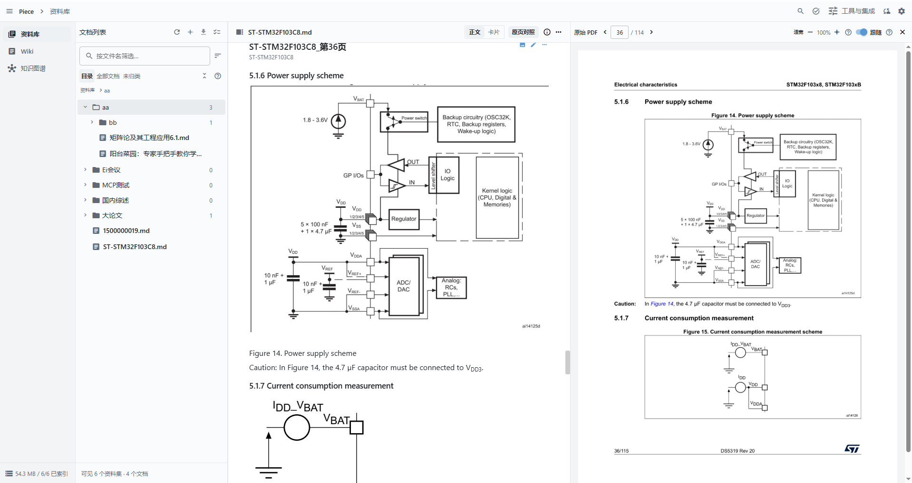
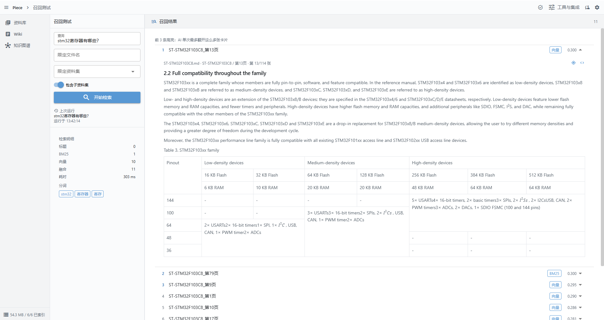
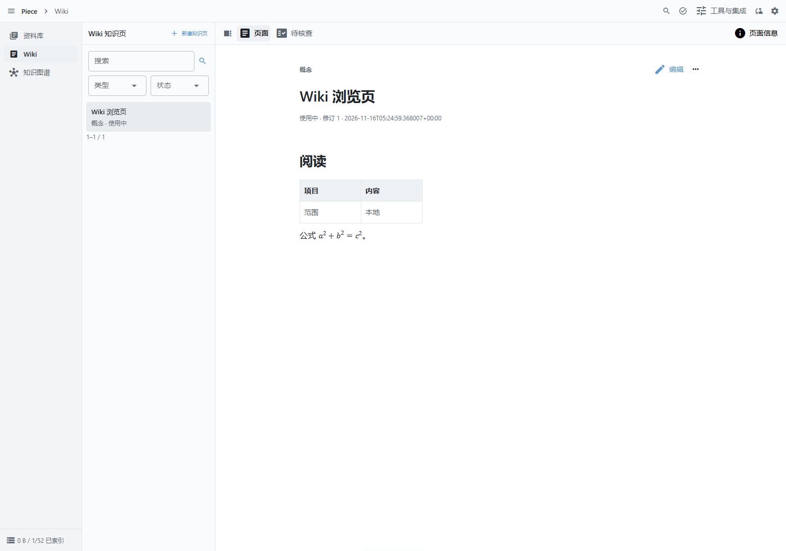
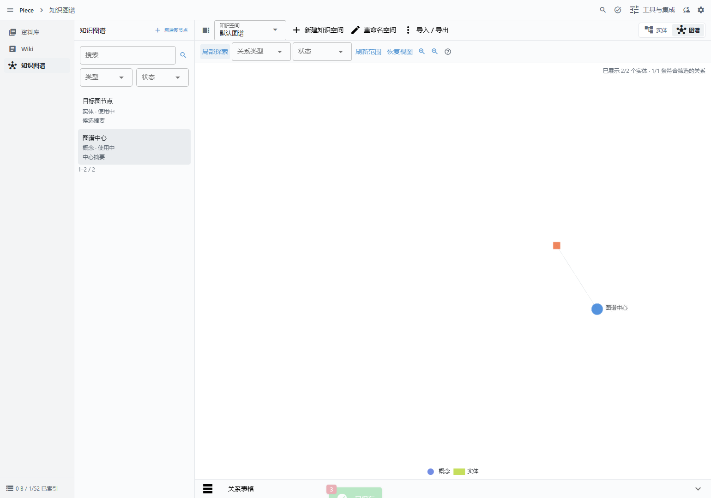

# Piece

**Keep your documents local. Let AI find them. Check the sources yourself.**

[Download for Windows](https://github.com/ultraplan-bit/Piece/releases) · [Quick start](#quick-start) · [User guide](docs/guide.en.md)

[简体中文](README.md) | **English**

Piece is a **local knowledge management tool**. Import PDFs, Office documents, and notes; search and edit their contents; and check the extracted text against original pages. Connect your usual AI client to look up documents, cite sources, and organize Wiki pages or a knowledge graph when you ask it to.

**Piece manages documents and knowledge; the conversation stays in your AI client.** Files and the knowledge base are stored locally, but relevant content may still be sent to cloud models, document parsing services, or your AI client's provider. Piece is not a built-in chatbot, and local storage does not mean fully offline processing.

## What you can do with Piece

### Bring scattered documents together

- Import PDF, Word, PowerPoint, Excel (`.xlsx`), Markdown, TXT, HTML, and EPUB into searchable, editable content fragments called **knowledge cards**.
- Organize documents with hierarchical collections. A document can belong to several collections, and one-shot imports from Obsidian and Zotero are supported.
- Configure OCR or a dedicated parsing service for scans, formulas, and complex tables rather than relying only on a PDF's text layer.

### Find content and check its sources

- Search by keywords or meaning without remembering the exact wording, with optional file or collection scope.
- Read relevant cards, correct their titles and text, and compare extraction results with original pages.
- Let your AI client retrieve documents and cite sources instead of uploading the same files for each conversation.

### Turn reading into reusable knowledge

- **Wiki pages**: organize explanations, comparisons, or conclusions as Markdown pages linked to source evidence.
- **Knowledge graph**: maintain entities and relationships separately, and inspect the sources supporting those connections.
- Manage them through the interface or ask AI to write and update them. **Importing documents does not automatically create a Wiki or graph, and conversations are not automatically saved.**

## A look at the Piece interface

Click any image to view it at full size. The Wiki and graph screenshots use sample content from a local isolated acceptance test.

<table>
  <tr>
    <td width="50%" align="center" valign="top">
      
       <b>Library · Source check</b> Compare extracted text with the original
    </td>
    <td width="50%" align="center" valign="top">
      
       <b>Recall Test</b> Ask a question and inspect the results
    </td>
  </tr>
  <tr>
    <td width="50%" align="center" valign="top">
      
       <b>Wiki page</b> Read and maintain topic knowledge
    </td>
    <td width="50%" align="center" valign="top">
      
       <b>Knowledge graph</b> Explore entities and their relationships
    </td>
  </tr>
</table>

## An example: read a manual, check the evidence, keep a note

Suppose you import an STM32 chip manual and want to check its power supply requirements:

1. **Find the evidence**: search in Piece's **Recall Test**, or ask an AI client connected to Piece:

   > Summarize the power supply precautions in the STM32 manual I imported. Quote the relevant text and identify the file and page numbers. Do not add claims that the manual does not support.

2. **Verify it**: use the returned source locations to open the content in Piece and compare the text, tables, and diagrams with the original PDF pages.
3. **Save only if needed**: after enabling Wiki access, explicitly ask AI to organize the verified conclusions into a knowledge page with source evidence for future reference.

The division of work is simple: **Piece supplies and stores documents, AI interprets and organizes them, and you decide what to keep.** Citations make checking easier; they do not guarantee that AI interpreted the source correctly.

## Quick start

### 1. Download and open

Download the Windows portable build from [Releases](https://github.com/ultraplan-bit/Piece/releases), **unzip it fully**, and double-click `Piece.exe`. No Python installation is needed; do not move the exe out of its folder.

macOS and Linux can [run from source](docs/guide.en.md#running-from-source) with the browser interface. Real-hardware compatibility is still being refined.

**For existing users**: v0.1.3 cannot open databases from v0.1.2 or earlier and provides no automatic migration. Keep the previous application and a full backup, and try this version in a new location with an empty data directory. See [Fully quit and back up](docs/guide.en.md#fully-quit-and-back-up).

### 2. Configure the search model

Open **Settings → Embedding & Indexing** and configure an embedding model. It creates the index used to search by meaning; it is not a chat model.

You can start with the default [SiliconFlow](https://siliconflow.cn/) provider: get an API key, enter it, leave the default endpoint and model unchanged, click **Test current input**, and then **Save this section** after a successful test. Other compatible services work too; external providers set their own prices and privacy policies.

### 3. Import a document and check that search works

Open **Library → + → Upload File**, choose a file, and wait for processing to finish. Start with a clearly readable text PDF or a Markdown file.

Then open **Tools & integrations → Recall Test** and search for something whose answer you know is in the document. Check the returned content. Scans or complex layouts need a suitable PDF parsing service configured first; see [Importing and organizing documents](docs/guide.en.md#importing-and-organizing-documents).

### 4. Give your AI access to the documents

If your AI client supports MCP, open **Tools & integrations → MCP Configuration**, choose the read-only **`piece-kb`** retrieval service first, and save and reload the client configuration provided by the page.

Once connected, ask in your AI client:

> Search the Piece knowledge base for material about this question. Quote the original text and cite the sources.

Get retrieval working first, then enable writes, Wiki, or graph access as needed. AI clients that can run local commands can also use exported skills; see [Connecting your AI](docs/guide.en.md#connecting-your-ai). Keep the Piece service running while using it.

## More capabilities and guides

| What you want to do | Where to start |
| --- | --- |
| Choose MCP services or export search and indexing skills | [Connecting your AI](docs/guide.en.md#connecting-your-ai) |
| Organize Wiki pages and evidence, or maintain entities and relationships | [Wiki and knowledge graph](docs/guide.en.md#wiki-and-knowledge-graph) |
| Import or export a graph for use with other tools | [Graph data exchange](docs/guide.en.md#graph-data-exchange) |
| Read local Zotero references, notes, and PDF annotations; import attachments when needed | [Working with Zotero](docs/guide.en.md#working-with-zotero) |
| Run from source or manage a knowledge base through the CLI | [Running from source](docs/guide.en.md#running-from-source) · [Command line](docs/guide.en.md#command-line) |
| Organize, export, or reparse documents; troubleshoot search | [Importing and organizing documents](docs/guide.en.md#importing-and-organizing-documents) · [FAQ](docs/guide.en.md#faq) |

## Data, privacy, and backups

- **Stored locally**: originals, knowledge cards, the database, and Wiki Markdown files. The actual location is configured by `data_path`; the Windows portable build defaults to `data/` beside the program.
- **May go to external services**: cloud embedding models receive indexing and search text; cloud parsers may receive documents or page images; your AI client receives the material you ask it to read. Check each service and its privacy policy before using sensitive documents.
- **Sync is not backup**: WebDAV cloud sync transfers files only, not a complete knowledge base. Before upgrading or moving, fully exit Piece and back up the whole data directory, including both the database and `wiki/`. Do not copy just the database.
- **Closing the window is not quitting**: to stop the Windows background service completely, choose **Quit** from the system tray.

See [Data and maintenance](docs/guide.en.md#data-and-maintenance) for more sync limits and maintenance precautions.

## Community and license

For problems or suggestions, open an [issue](https://github.com/ultraplan-bit/Piece/issues) with reproduction steps and redacted screenshots. Do not upload keys or private documents.

This project recognizes and links to the [LINUX DO](https://linux.do) community and is released under the [MIT License](LICENSE).
