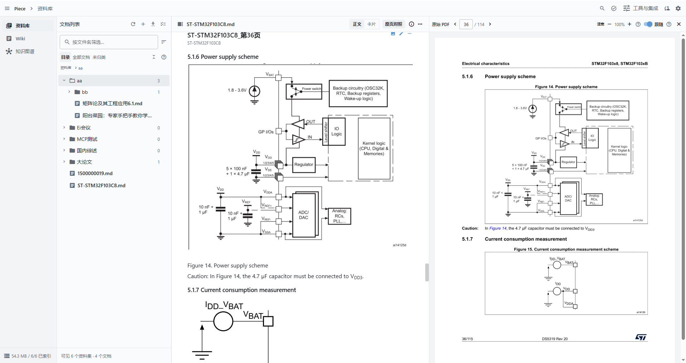
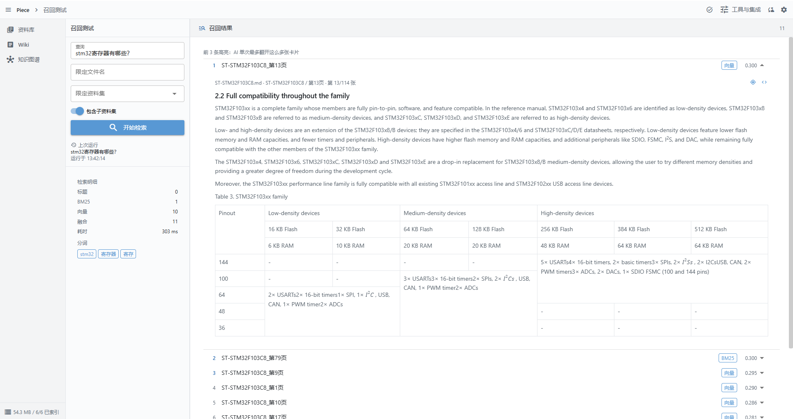
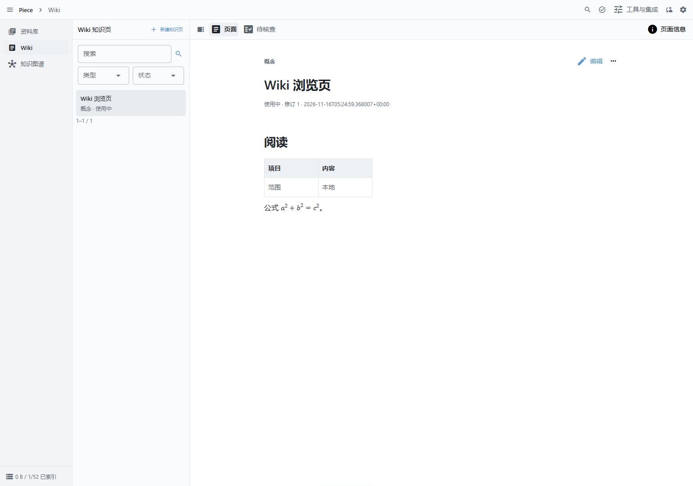
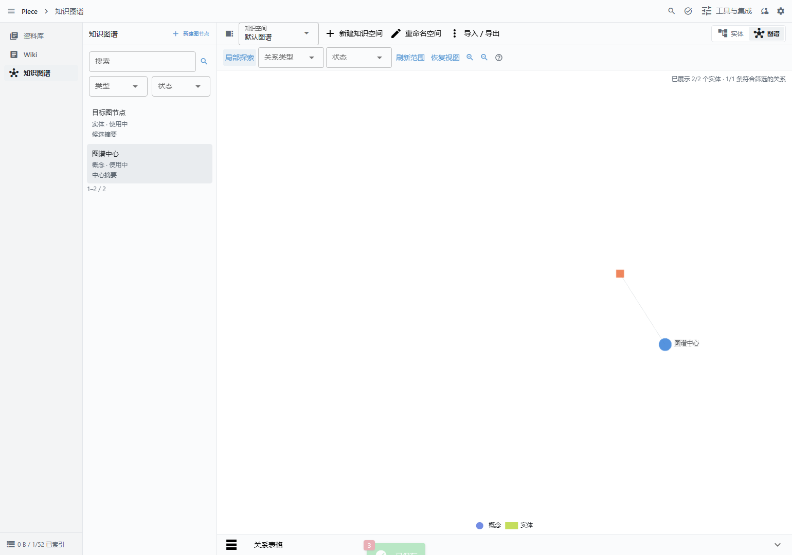

# Piece

**管理本地资料，让 AI 查得到，让你核对得了。**

[下载 Windows 版](https://github.com/ultraplan-bit/Piece/releases) · [快速开始](#快速开始) · [使用指南](docs/guide.md)

**简体中文** | [English](README.en.md)

Piece 是一个**本地知识管理工具**。把 PDF、Office 文档和笔记导入后，你可以检索、编辑其中的内容，并对照原页核查；接入你常用的 AI 客户端后，还可以让 AI 查资料、引用来源，按需整理知识页和知识图谱。

**Piece 管理资料和知识，聊天仍在你的 AI 客户端中进行。** 文件和知识库保存在本机，但使用云端模型、文档解析服务或 AI 客户端时，相应内容仍可能发送给这些服务。它不是一个内置聊天机器人，也不等于完全离线运行。

## 你可以用 Piece 做什么

### 把分散的资料收进来

- 导入 PDF、Word、PPT、Excel（`.xlsx`）、Markdown、TXT、HTML 和 EPUB，解析成可检索、可编辑的内容片段，也就是「知识卡片」。
- 用层级集合分类，一份资料可以放进多个集合；也支持从 Obsidian、Zotero 一次性导入资料。
- 扫描件、公式和复杂表格可以配置 OCR 或专用解析服务，不必只依赖 PDF 的文字层。

### 找到内容，也能核对来源

- 按关键词或含义检索，不必记住原文的准确说法；也可以限定文件或集合范围。
- 查看相关知识卡片、修正标题和正文，对照原页检查解析结果。
- 让 AI 客户端检索资料、取回原文并引用来源，而不是每次重新上传整份文档。

### 把读过的资料整理成知识

- **Wiki 知识页**：把一个主题的说明、比较或结论整理成 Markdown 页面，并关联原文证据。
- **知识图谱**：单独维护实体与关系，查看概念之间的联系和支持这些关系的来源。
- 通过界面管理，或让 AI 按你的要求写入和更新。**导入资料不会自动生成 Wiki 和图谱，也不会自动保存每次聊天。**

## 看看 Piece 的工作界面

点击任一图片可查看大图。Wiki 和图谱截图中的内容来自本地隔离验收示例。

<table>
  <tr>
    <td width="50%" align="center" valign="top">
      
       <b>资料库 · 原页核对</b> 对照原文检查解析结果
    </td>
    <td width="50%" align="center" valign="top">
      
       <b>检索测试</b> 提问并检查找到的内容
    </td>
  </tr>
  <tr>
    <td width="50%" align="center" valign="top">
      
       <b>Wiki 知识页</b> 阅读并维护主题知识
    </td>
    <td width="50%" align="center" valign="top">
      
       <b>知识图谱</b> 查看实体及其关系
    </td>
  </tr>
</table>

## 一个使用例子：读手册，查依据，留下笔记

假设你导入了一份 STM32 芯片手册，想确认供电方面的注意事项：

1. **先查资料**：在 Piece 的「召回测试」里搜索，或在接好 Piece 的 AI 客户端中提问：

   > 根据我导入的 STM32 手册，整理供电方面的注意事项。请引用相关原文，标明文件和页码；没有依据的内容不要补充。

2. **再核对**：根据返回的来源，在 Piece 中打开对应内容，对照 PDF 原页检查文字、表格和图示。
3. **需要时再保存**：启用 Wiki 能力后，明确要求 AI 把核对过的结论整理成带来源证据的知识页，留待下次查阅。

这里的分工是：**Piece 提供和保存资料，AI 负责理解与整理，你决定哪些结论值得留下。** 引用便于核查，但不保证 AI 的理解一定正确。

## 快速开始

### 1. 下载并打开

前往 [Releases](https://github.com/ultraplan-bit/Piece/releases)，下载 Windows 便携版，**完整解压后**双击 `Piece.exe`。不用安装 Python，也不要把 exe 单独移出文件夹。

macOS / Linux 可通过[源码运行](docs/guide.md#源码运行)，使用浏览器界面，实机兼容性仍在完善。

**旧版用户请注意**：v0.1.3 不兼容 v0.1.2 及更早版本的旧数据库，也不自动迁移；请保留旧版和完整备份，在新目录中使用空数据目录体验新版，详见[完全退出与备份](docs/guide.md#完全退出与备份)。

### 2. 配置检索模型

打开 **设置 → 嵌入与索引**，配置嵌入模型。它用于把资料转换成可按含义检索的索引，不是聊天模型。

第一次可以使用默认的[硅基流动](https://siliconflow.cn/)：获取 API Key 并填入，地址和模型先保留默认值，点击「测试当前输入」，成功后点击「保存当前分组」。也支持其他兼容服务；外部服务的费用与隐私政策以服务商为准。

### 3. 导入一份资料，确认能找到内容

在 **资料库 → + → 上传文件** 中选择文件，等待处理完成。第一次建议用一份文字清晰的 PDF 或 Markdown。

然后打开 **工具与集成 → 召回测试**，搜索文档中一个你知道答案的问题，检查返回的内容。扫描件或复杂版面需要先在设置中配置 PDF 解析服务，详见[文档导入与整理](docs/guide.md#文档导入与整理)。

### 4. 让你的 AI 使用资料

如果你使用的 AI 客户端支持 MCP，打开 **工具与集成 → MCP 配置**，先选择只读检索服务 **`piece-kb`**，按页面提供的客户端配置保存并重新加载。

接好后，可以在 AI 客户端里说：

> 从 Piece 知识库中查找这个问题的相关资料，引用原文并标明出处。

先把检索用通，再按需启用写入、Wiki 或图谱能力。支持本机命令行的 AI 也可以使用导出的 Skill，选择方法见[接入 AI](docs/guide.md#接入-ai)。使用时请保持 Piece 服务运行。

## 更多能力与使用指南

| 想做什么 | 从哪里开始 |
| --- | --- |
| 选择 MCP 服务，或导出检索、建库等 Skill | [接入 AI](docs/guide.md#接入-ai) |
| 整理 Wiki 页面、引用证据，维护实体与关系 | [Wiki 与知识图谱](docs/guide.md#wiki-与知识图谱) |
| 导入或导出图谱，与其他工具交换数据 | [图谱数据交换](docs/guide.md#图谱数据交换) |
| 查阅本机 Zotero 书目、笔记和 PDF 批注，按需导入附件 | [Zotero 协作](docs/guide.md#zotero-协作) |
| 从源码启动，或通过 CLI 管理知识库 | [源码运行](docs/guide.md#源码运行) · [命令行](docs/guide.md#命令行) |
| 分类资料、导出内容、重新解析，或排查检索问题 | [文档导入与整理](docs/guide.md#文档导入与整理) · [常见问题](docs/guide.md#常见问题) |

## 数据、隐私与备份

- **保存在本机**：原始文件、知识卡片、数据库和 Wiki Markdown 文件。实际目录由设置中的 `data_path` 决定，Windows 便携版默认在程序旁的 `data/`。
- **可能发送到外部服务**：云端嵌入模型接收用于索引和检索的文本；云端解析服务可能接收文档或页面图像；AI 客户端会取得你让它查阅的资料。敏感资料请先确认每个环节的服务与隐私政策。
- **备份不是同步**：WebDAV 云同步只同步文件，不是完整知识库备份。升级或迁移前，请完全退出 Piece，再备份整个数据目录，包含数据库和 `wiki/`；不要只复制数据库。
- **关闭窗口不等于退出**：Windows 版要完全停止后台服务，请在系统托盘中选择「退出」。

更多同步限制和维护注意事项见[数据与维护](docs/guide.md#数据与维护)。

## 社区与许可证

遇到问题或有建议，欢迎[提交 Issue](https://github.com/ultraplan-bit/Piece/issues)，请附上复现步骤和脱敏截图，不要上传密钥或私人资料。

本项目认可并链接 [LINUX DO](https://linux.do) 社区，基于 [MIT 许可证](LICENSE) 开源。
